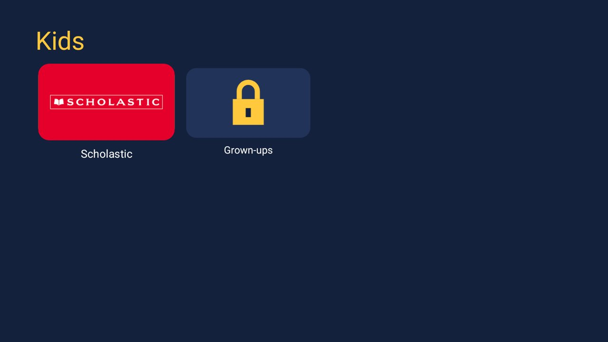
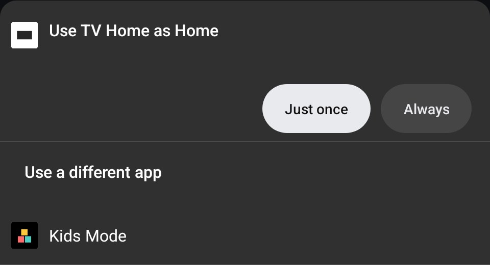

  

  <strong>A PIN-locked kids' screen for Android TV: their apps, and nothing else</strong>

  
  
  
  

<h1>Kids Mode</h1>

Kids Mode turns an Android TV into a kids' screen locked with a PIN: big tiles for the apps you choose (YouTube Kids, Scholastic, PBS KIDS and similar start there), and nothing else. Home, the remote's Settings key and any app the kids' apps link to all lead back to it, until a grown-up gives the PIN. While it's off, Home is your normal launcher, exactly as before.

<h2>Screenshots</h2>

  
  &nbsp;&nbsp;
  

Left: the kids' screen. Right: Android's own Home chooser, on a TV with two home apps and none chosen.

<h2>Features</h2>

<ul>
  <li><strong>The kids' screen</strong>: big tiles for the chosen apps and a Grown-ups tile; Back does nothing</li>
  <li><strong>A guard</strong>: while Kids Mode is on, any app that isn't on the kids' screen is sent back to it (Settings from the remote's key, the full YouTube from a link, another launcher). The on-screen keyboard and the volume bar are let through</li>
  <li><strong>Hands Home back</strong>: while Kids Mode is off, Home goes straight to your normal launcher</li>
  <li><strong>The parents' screen</strong>: start Kids Mode, pick the kids' apps, change the PIN or use a password, choose the normal home app, check the guard</li>
  <li><strong>A PIN that isn't stored</strong>: only a salted PBKDF2 hash; after five wrong tries each try waits, 30 seconds doubling up to 5 minutes</li>
  <li><strong>Small and private</strong>: plain Java, no libraries, no internet permission, no accounts or analytics</li>
  <li>A <a href="https://github.com/Gathin23/cleanyourtv/blob/main/docs/modules.md">module card</a> for the <a href="https://github.com/Gathin23/cleanyourtv">Clean Your TV</a> launcher ("Kids Mode", yellow glow, opens the parents' screen); on any other home it's an ordinary app</li>
</ul>

<h2>Requirements</h2>

<ul>
  <li>An Android TV or Google TV device on <strong>Android 8.0 or newer</strong></li>
  <li>A computer with <a href="https://developer.android.com/tools/releases/platform-tools">ADB</a> and network debugging on the TV: Kids Mode has to become the home app and switch on its guard, and many TVs have no screens for either</li>
</ul>

<h2>Installation and Setup</h2>

<h3>From a release (recommended)</h3>

<ol>
  <li>Download <code>KidsMode-x.y.z.apk</code> from the <a href="../../releases/latest">latest release</a>.</li>
  <li>Install it, make it the home app and switch on the guard:
<pre>
TV_HOST=&lt;tv ip&gt; APK=KidsMode-0.1.0.apk ./install.sh
</pre>
  </li>
  <li>The parents' screen opens on the TV: choose a PIN (typed twice), check the kids' apps, then <strong>Start Kids Mode</strong>.</li>
</ol>

To undo: <code>TV_HOST=&lt;tv ip&gt; ./install.sh --off &lt;your launcher's package/activity&gt;</code> puts your launcher back as home and switches the guard off. Uninstalling Kids Mode does the same.

<h3>From source</h3>

JDK 17 and Android SDK platform 34 with build-tools 34.0.0:

<pre>
TV_HOST=&lt;tv ip&gt; ./install.sh
</pre>

To build only: <code>./gradlew assembleRelease</code>; the JVM tests run with <code>./gradlew testReleaseUnitTest</code>. Where macOS blocks the stock <code>adb</code>, set <code>CLEANYOURTV</code> to a clone of <a href="https://github.com/Gathin23/cleanyourtv">Clean Your TV</a> with its tools set up, and its <code>tools/tv.py</code> is used instead.

<h2>Usage</h2>

<table>
  <tr><th>Parents' screen</th><th>What it does</th></tr>
  <tr><td><strong>Start Kids Mode</strong></td><td>Switches it on and shows the kids' screen.</td></tr>
  <tr><td><strong>Kids' apps</strong></td><td>Every TV app on the TV; OK puts one on the kids' screen or takes it off. YouTube Kids and apps from children's publishers start on it. The full YouTube does not.</td></tr>
  <tr><td><strong>Change the PIN</strong>, <strong>Use a password instead</strong></td><td>A PIN on a number pad worked with the D-pad (number keys work too); a password, with the TV's keyboard.</td></tr>
  <tr><td><strong>Normal home app</strong></td><td>What Home shows while Kids Mode is off; OK picks the next one.</td></tr>
  <tr><td><strong>Guard</strong>, <strong>Kids Mode is the home app</strong></td><td>Whether both are set up, with shortcuts to the settings.</td></tr>
</table>

The parents' screen opens from the app's tile (or its card) and asks for the PIN every time. On the kids' screen, <strong>Grown-ups</strong> asks for the PIN; with it, Kids Mode switches off and Home is your launcher again.

<h2>How It Works</h2>

<pre>
 Home key ──► Kids Mode (home app) ──► off? ──► your launcher, at once
                                   └─► on?  ──► the kids' screen

 Any app comes to the front ──► guard (accessibility) ──► on the kids' screen? ──► stays
                                                      └─► not allowed ──► back to the kids' screen
</pre>

<ul>
  <li><strong>Kids Mode is the TV's home app</strong>, set with <code>cmd package set-home-activity</code>. While off, it starts your launcher straight away: on a cold reboot the launcher was in front 0.3 s after Kids Mode started, with nothing of Kids Mode on screen.</li>
  <li><strong>The guard</strong> is an accessibility service with <code>canRetrieveWindowContent="false"</code>. It learns which app's window is in front and nothing else: never what's on screen, never keys.</li>
  <li><strong>Uninstalling leaves a working Home</strong>: Android falls back to your launcher and removes the guard from the enabled services.</li>
</ul>

<h2>Known Limitations</h2>

<ul>
  <li><strong>It is a guard, not a vault.</strong> An app that isn't on the kids' screen can show for a moment before it is sent back. HDMI inputs reached with the remote's Input key are system windows on some TVs and may not be guarded. It suits small children, not a determined teenager with a computer and ADB.</li>
  <li><strong>Apps on the kids' screen are trusted.</strong> Whatever an allowed app shows inside itself is up to that app, which is why the full YouTube doesn't start on it.</li>
  <li><strong>Clearing the app's data</strong> (Settings → Apps) also switches the guard off and removes the PIN; Settings itself is guarded while Kids Mode is on.</li>
  <li><strong>A home app chooser.</strong> When two home apps are installed and none is chosen, Android asks (see Screenshots). <code>install.sh</code> chooses for you; some TVs have no screen to choose at all.</li>
</ul>

<h2>Tested On</h2>

MOKA R8G (Android 14) with the Scholastic app, over ADB:

<ul>
  <li>A new PIN typed twice on the number pad. The parents' screen found Scholastic and left the full YouTube and Disney+ off.</li>
  <li>Start Kids Mode showed the kids' screen, and Scholastic opened from it.</li>
  <li>The guard sent Settings (from an intent and from the remote's Settings key), Netflix and Home back to the kids' screen.</li>
  <li>Grown-ups with the PIN switched Kids Mode off and handed Home to the normal launcher, and Home went there afterwards too.</li>
  <li>With Kids Mode off, a cold reboot landed on the launcher.</li>
  <li>Uninstalling left a working Home. With two home apps and none chosen, Android's chooser appeared.</li>
</ul>

YouTube Kids wasn't installed on the test TV. The JVM tests cover the PIN rules and hash, the wait after wrong tries, which apps start on the kids' screen and what the guard lets through.

<h2>License</h2>

This project is licensed under the MIT License.

See the [LICENSE](LICENSE) file for details.
Full license text: https://opensource.org/licenses/MIT

<h2>Contributing</h2>

Pull requests are welcome. Open an issue first to discuss ideas or report bugs; report ways past the guard privately (see <a href="SECURITY.md">SECURITY.md</a>). See <a href="CONTRIBUTING.md">CONTRIBUTING.md</a> and the <a href="CODE_OF_CONDUCT.md">Code of Conduct</a>.

<h2>Related Projects</h2>

<ul>
  <li><a href="https://github.com/Gathin23/cleanyourtv">Clean Your TV</a>: debloat tools and a lean launcher for Android TV, whose module cards Kids Mode supports (it started as an add-on there)</li>
  <li><a href="https://github.com/maxhayim/webmote">Webmote</a>: a remote for Android TV in your phone's or computer's browser</li>
  <li><a href="https://github.com/maxhayim/corner-player">Corner Player</a>: your own camera or stream in a corner of the TV, over any app</li>
</ul>

<h2>Acknowledgments</h2>

Thanks to the Clean Your TV maintainer for the review and the Home tests asked for there. The icon and art are Kids Mode's own. 
Android™, Android TV™ and Google TV™ are trademarks of Google LLC; Scholastic is a trademark of Scholastic Inc.; YouTube Kids, PBS KIDS, Netflix and Disney+ are trademarks of their owners. They are used here solely to describe compatibility.
All other trademarks are the property of their respective owners.

